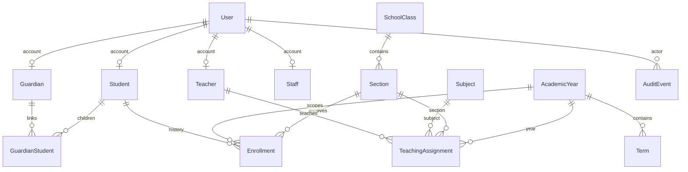
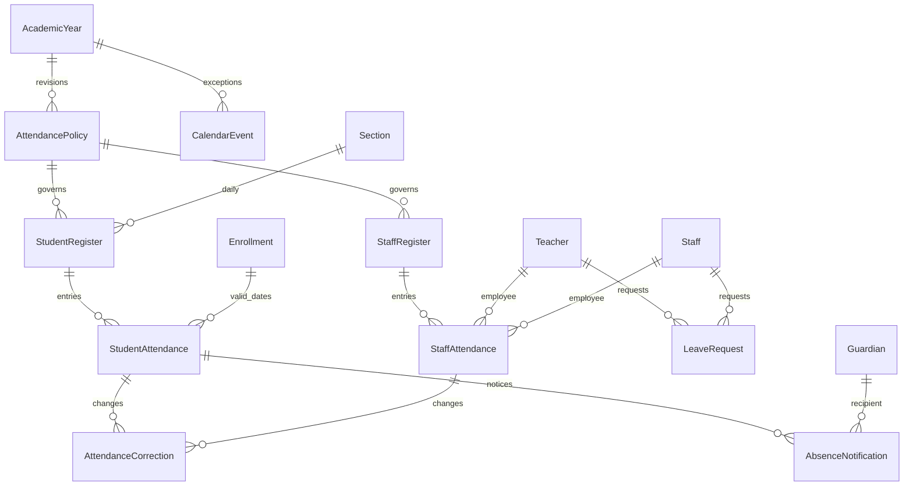
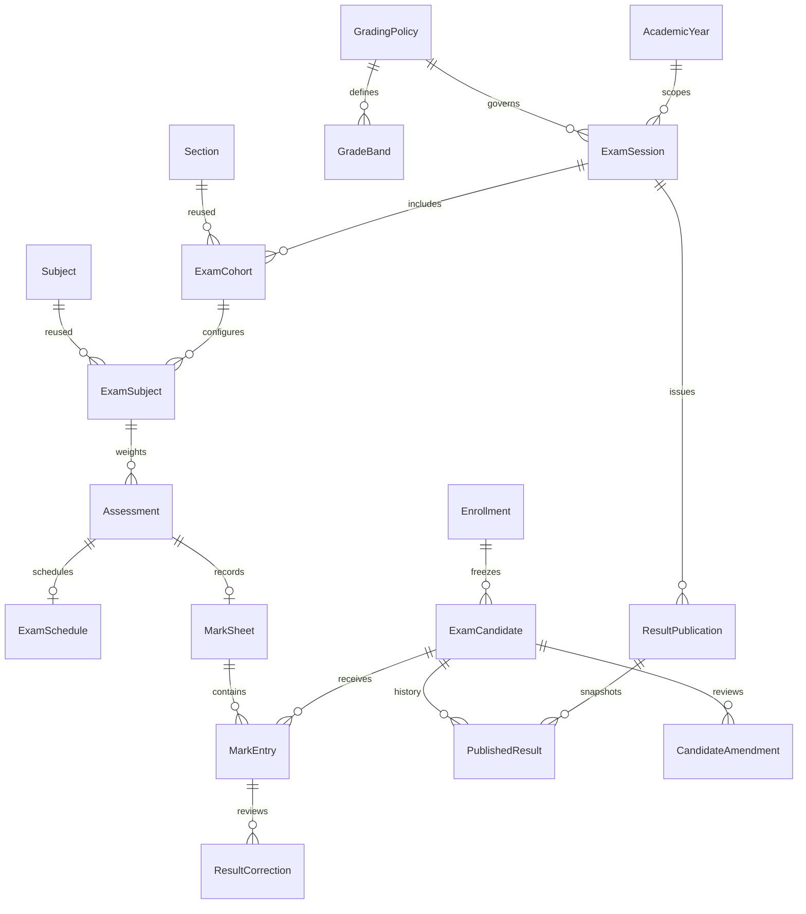

# Database design

## Foundation relationships

User accounts are independent from people profiles; a profile may exist before
an account is provisioned. Deleting an account detaches profiles, retaining school
records. Enrollment, guardian links, assignments and academic references use
PROTECT. Audit actors use SET_NULL and retain a non-sensitive target identifier.

SchoolSettings is a singleton for one school, with an explicit timezone and
currency boundary. It is not a multi-tenant architecture. Future multi-school
support requires school foreign keys, scoped uniqueness and tenant access tests.

Academic years and terms have ordered date checks. Only one academic year can be
current. Terms must fall within their year (model validation). A student may have
multiple dated section placements in one year; one active placement per student
and year is enforced by a conditional unique constraint. Historical placement rows
are retained when a student changes class; close the previous placement and create
a new row in a transaction. Date ranges must not overlap (model validation);
enrollment write services now lock academic years and the student row. A PostgreSQL
`btree_gist` exclusion constraint additionally rejects overlapping date ranges across
years, and a partial unique constraint allows one active placement per student
across all years. Active roll numbers are unique within the year/section. A class is
derived from its section, avoiding a redundant class key.

Guardian links are explicit and unique per guardian/student. Assignments are unique
per teacher, subject, section and year. Record visibility matches the enrollment
year and section of teacher assignments. Subject-mark and attendance endpoints do
not exist yet and must enforce subject/date scope when implemented.

User email is required and case-insensitively unique at the database level.
Usernames remain Django's case-sensitive identifiers. Database indexes support
enrollment lookup by year/section/status and event lookup by type/date. UUID student
identifiers avoid sequential record URLs; authorization remains mandatory.

Future finance values use DecimalField, never floats. Marks use bounded
DecimalField values with database checks against assessment maximums. Neither
operational table is created in this foundation. All timestamps are timezone
aware; the default school timezone is Asia/Karachi.

Application validators run in ModelForm/admin and seed services; database checks
also protect critical single-row invariants. Direct ORM writes do not automatically
run full_clean. New write services must explicitly validate and use transactions.

Phase 2 adds year/term status and current-term constraints, year/class subject
assignments, admission/birth dates, employment/contact details and private image
references. Student numbers and external source references are case-insensitively
unique. A singleton counter allocates admission numbers under a row lock.
AdmissionImport stores owner, expiry, confirmation timestamp and transient JSON rows.
An enrollment trigger rejects deletion, modification of completed rows, changes to
placement identity, dates outside the parent year and writes into closed years.
Active roll corrections remain allowed and audited by their service. Upgrade tests
verify legacy admission numbers, dated placements and assignments survive migration.

## Phase 3 attendance relationships and integrity

Registers are unique per year/section/date or year/staff/date, with draft/final state,
optimistic version and submitter/timestamp. Student rows reference their original
Enrollment with PROTECT and carry checked student/date keys for global daily uniqueness.
Staff rows use exactly one existing teacher/staff profile; one account's teacher
profile takes precedence when both profiles exist. Department and optional employment
end dates extend the existing profiles for reporting.

PostgreSQL constraints enforce daily uniqueness, valid statuses, paired submission/
decision fields, one pending correction per entry, no self-approval, ordered leave
ranges and non-overlapping pending/approved leave via btree_gist exclusion constraints.
A notification has a unique guardian/entry/revision and only one active notice per
entry/guardian. Used policies and reviewed requests retain immutable history.

Triggers validate enrollment/employee/date/register consistency, require complete
rosters on finalization, reject direct final-record edits/deletion, require matching
approved original/revised correction values, protect decisions and notification
identity, reject future registers using the school timezone, and preserve date-bound
source relationships. Calendar exceptions are append-only with audited cancellation.
Applications use ordered year locks and scoped transactional services in addition
to these database protections. The application database role must not manage schema
or disable triggers.

Register entry writes are batched. Aggregates operate over scoped finalized rows
and an in-memory working-date calendar for the selected bounded year/range, avoiding
queries per student/day. Indexed dates/statuses, unique daily keys and explicit
pagination support operational lookups. A test compares register query counts for
one versus twenty-one students. Production-scale performance remains to be validated.

## Phase 4 examinations

Twenty-three examination models reuse the existing academic/people foreign keys:

- AssessmentType and ExaminationSettings: school-defined assessment labels and
  opt-in ranking/support settings.
- GradingPolicy and GradeBand: year-specific Decimal thresholds, contiguous bands,
  grade points, status/rounding and independent/principal-review rules.
- ExamSession, ExamController, ExamCohort, ExamSubject, Assessment and
  SessionContribution: dated sessions, explicit controller links, sections, subject
  structures, weighted components and published term/annual source references.
- ExamRoom, ExamSchedule and Invigilation: optional locations/duties and time slots.
- ExamCandidate, MarkSheet and MarkEntry: frozen dated Enrollment identity,
  optimistic sheet/entry versions and status-aware marks.
- ResultPublication and PublishedResult: append-only issue batches and candidate
  snapshots, including school identity, image bytes, applied rules and source versions.
- ResultCorrection and CandidateAmendment: exact before/after proposals and one
  independent final decision for marks, remarks or visibility changes.
- ResultEvent, ExamNotification and PromotionRecommendation: attributed workflow
  history, recipient-scoped internal notices and reasoned recommendation overrides.

Five migrations add the schema, guards, amendment/retake support, grading overlap
exclusion, schedule guards and reporting indexes. Earlier migrations remain intact.
Foreign keys protect enrollment, policy, candidate, marks and publication history.
Unique constraints prevent duplicate candidates/session, subjects/cohort, assessment
names, sheet entries, controller links, source sessions, publication versions and
notifications; only one pending correction/amendment is permitted per target.

PostgreSQL exclusions protect class/section/room/invigilator time ranges and grade-band
ranges. Checks enforce ordered dates, positive maxima/weights, 0?100 thresholds,
status-aware null marks, independent decision metadata and valid sheet states.
Guards enforce matching candidate enrollment/roster, maximum marks, complete sheet
submission, frozen setup/used policies, approved correction tokens, exact before/after
revisions, append-only snapshots/events and original final-approval identity.

Academic-year locks serialize setup, marks, approvals, publication and enrollment
changes; stale form versions fail before writes. Batched roster/snapshot writes,
correlated assignment scopes and shared grading context avoid per-student lookup
queries. Foreign-key, unique and exclusion indexes are complemented by year/state,
recipient/date and candidate/publication indexes. The public report limit is 5,000
rows; operational load testing remains required for a real school.
