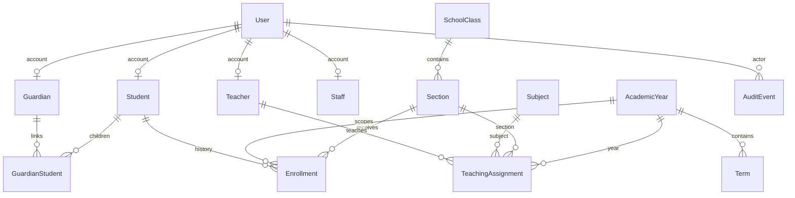

# Database design

## Foundation relationships

User accounts are independent from people profiles; a profile may exist before
an account is provisioned. Deleting an account detaches profiles, retaining school
records. Enrollment, guardian links, assignments and academic references use
PROTECT. Audit actors use SET_NULL and retain a non-sensitive target identifier.

SchoolSettings is a singleton for one school, with an explicit timezone and
currency boundary. It is not a multi-tenant architecture. Future multi-school
support requires school foreign keys, scoped uniqueness and tenant access tests.

Academic years and terms have ordered date checks. Only one academic year can be
current. Terms must fall within their year (model validation). A student may have
multiple dated section placements in one year; one active placement per student
and year is enforced by a conditional unique constraint. Historical placement rows
are retained when a student changes class; close the previous placement and create
a new row in a transaction. Date ranges must not overlap (model validation);
enrollment write services now lock academic years and the student row. A PostgreSQL
`btree_gist` exclusion constraint additionally rejects overlapping date ranges across
years, and a partial unique constraint allows one active placement per student
across all years. Active roll numbers are unique within the year/section. A class is
derived from its section, avoiding a redundant class key.

Guardian links are explicit and unique per guardian/student. Assignments are unique
per teacher, subject, section and year. Record visibility matches the enrollment
year and section of teacher assignments. Subject-mark and attendance endpoints do
not exist yet and must enforce subject/date scope when implemented.

User email is required and case-insensitively unique at the database level.
Usernames remain Django's case-sensitive identifiers. Database indexes support
enrollment lookup by year/section/status and event lookup by type/date. UUID student
identifiers avoid sequential record URLs; authorization remains mandatory.

Future finance values use DecimalField, never floats. Marks use bounded
DecimalField values with database checks against assessment maximums. Neither
operational table is created in this foundation. All timestamps are timezone
aware; the default school timezone is Asia/Karachi.

Application validators run in ModelForm/admin and seed services; database checks
also protect critical single-row invariants. Direct ORM writes do not automatically
run full_clean. New write services must explicitly validate and use transactions.

Phase 2 adds year/term status and current-term constraints, year/class subject
assignments, admission/birth dates, employment/contact details and private image
references. Student numbers and external source references are case-insensitively
unique. A singleton counter allocates admission numbers under a row lock.
AdmissionImport stores owner, expiry, confirmation timestamp and transient JSON rows.
An enrollment trigger rejects deletion, modification of completed rows, changes to
placement identity, dates outside the parent year and writes into closed years.
Active roll corrections remain allowed and audited by their service. Upgrade tests
verify legacy admission numbers, dated placements and assignments survive migration.
